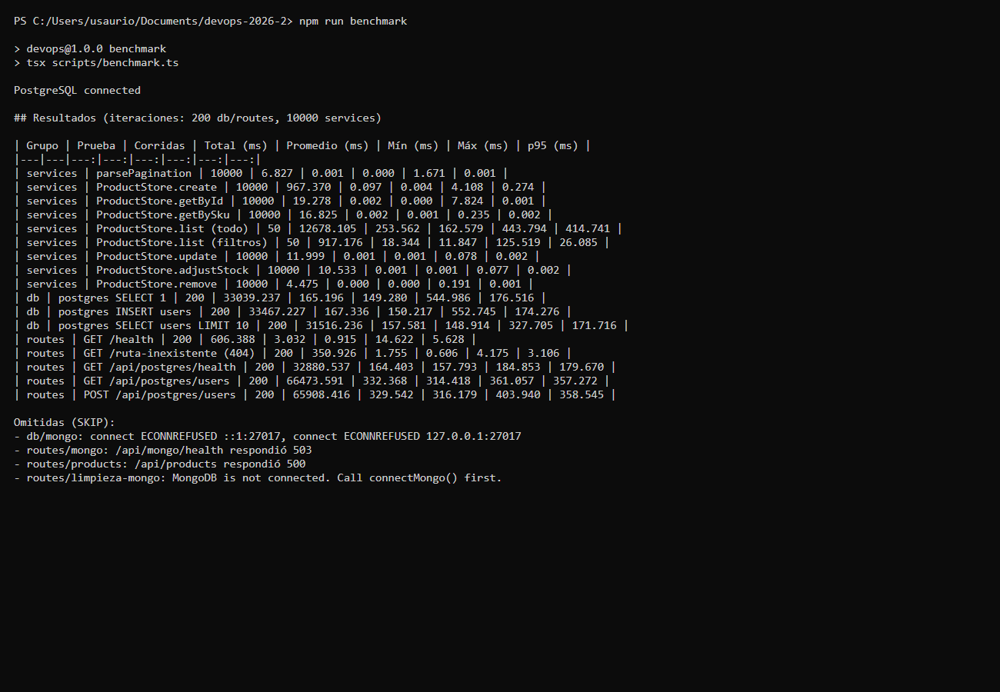

# Express + TypeScript API (PostgreSQL + MongoDB)

API en Node.js con Express y TypeScript que expone endpoints contra PostgreSQL y MongoDB.

## Requisitos

- Node.js 18+
- Docker / Docker Compose (recomendado)
- O PostgreSQL y MongoDB locales si no usas Docker

## Configuración

1. Copia el archivo de entorno:

```bash
cp .env.example .env
```

2. Ajusta credenciales en `.env` si hace falta.

## Arranque con Docker (API + Postgres + Mongo)

Levanta todo el stack:

```bash
npm run docker:up
```

API en `http://localhost:3000`. Logs y parada:

```bash
npm run docker:logs
npm run docker:down
```

Solo bases de datos (API en local con `npm run dev`):

```bash
docker compose up -d postgres mongo
```

## Instalación y arranque local

```bash
npm install
npm run dev
```

Build de producción:

```bash
npm run build
npm start
```

## Endpoints

| Método | Ruta | Descripción |
|--------|------|-------------|
| GET | `/health` | Health del API |
| GET | `/api/postgres/health` | Health de PostgreSQL |
| GET | `/api/postgres/users?page=1&limit=10` | Lista usuarios paginados (Postgres) |
| POST | `/api/postgres/users` | Crea usuario (Postgres) |
| GET | `/api/mongo/health` | Health de MongoDB |
| GET | `/api/mongo/users?page=1&limit=10` | Lista usuarios paginados (Mongo) |
| POST | `/api/mongo/users` | Crea usuario (Mongo) |

### Ejemplos

```bash
curl http://localhost:3000/health

curl http://localhost:3000/api/postgres/health
curl -X POST http://localhost:3000/api/postgres/users ^
  -H "Content-Type: application/json" ^
  -d "{\"name\":\"Ana\",\"email\":\"ana@example.com\"}"

curl http://localhost:3000/api/mongo/health
curl -X POST http://localhost:3000/api/mongo/users ^
  -H "Content-Type: application/json" ^
  -d "{\"name\":\"Luis\",\"email\":\"luis@example.com\"}"
```

Body esperado en POST `/users`:

```json
{
  "name": "Nombre",
  "email": "correo@example.com"
}
```
## Levantar con Docker

### Requisitos previos
- Docker Desktop instalado y corriendo
- Node.js 18+ (opcional si solo vas a usar Docker)

### Pasos

1. Copia el archivo de entorno:
```bash
   cp .env.example .env
```
   En Windows PowerShell:
```powershell
   Copy-Item .env.example .env
```

2. Levanta el stack completo (API + PostgreSQL + MongoDB):
```bash
   docker compose up --build -d
```

3. Verifica que los tres contenedores estén corriendo y en estado `healthy`:
```bash
   docker compose ps
```

4. Prueba los endpoints de salud:
```bash
   curl http://localhost:3000/health
   curl http://localhost:3000/api/postgres/health
   curl http://localhost:3000/api/mongo/health
```

   > **Nota (Windows/PowerShell):** usa `curl.exe` en lugar de `curl` para evitar que PowerShell lo interprete como `Invoke-WebRequest`.

5. Prueba la creación de usuarios:
```bash
   curl -X POST http://localhost:3000/api/postgres/users \
     -H "Content-Type: application/json" \
     -d '{"name":"Ana","email":"ana@example.com"}'

   curl -X POST http://localhost:3000/api/mongo/users \
     -H "Content-Type: application/json" \
     -d '{"name":"Luis","email":"luis@example.com"}'
```

   En Windows PowerShell, usa `Invoke-RestMethod` en su lugar:
```powershell
   Invoke-RestMethod -Uri "http://localhost:3000/api/postgres/users" -Method Post -ContentType "application/json" -Body '{"name":"Ana","email":"ana@example.com"}'

   Invoke-RestMethod -Uri "http://localhost:3000/api/mongo/users" -Method Post -ContentType "application/json" -Body '{"name":"Luis","email":"luis@example.com"}'
```

6. Revisa los logs del servicio API si necesitas depurar algo:
```bash
   docker compose logs -f api
```

7. Para detener el stack:
```bash
   docker compose down
```

### Arquitectura del stack
- **api** — Node.js/Express/TypeScript, expuesto en el puerto `3000`
- **postgres** — PostgreSQL 16, expuesto en el puerto `5432`
- **mongo** — MongoDB 7, expuesto en el puerto `27017`

Dentro de la red de Docker, la API se conecta a las bases usando el nombre del servicio (`postgres` y `mongo`), no `localhost`.

## Medición de rendimiento

Cada carpeta tiene su propio .ts de benchmark, y un runner los ejecuta todos:

| Archivo | Qué mide |
|---|---|
| `src/services/services.benchmark.ts` | `parsePagination` y los métodos de `ProductStore` (en memoria) |
| `src/db/db.benchmark.ts` | ping, insert y select directo en PostgreSQL y MongoDB |
| `src/routes/routes.benchmark.ts` | peticiones HTTP reales a cada ruta de la API |
| `scripts/benchmark.ts` | runner que ejecuta los tres e imprime la tabla |

Ejecutar con las bases de Docker (Postgres y Mongo locales, con los valores por defecto de `.env.example`):

```bash
cp .env.example .env            # en PowerShell: Copy-Item .env.example .env
docker compose up -d postgres mongo
npm install
npm run benchmark
```

También funciona con bases externas: basta con poner sus datos en `.env` (para Postgres en la nube, `POSTGRES_SSL=true`).

```bash
npm run benchmark
# opcional: ITERATIONS=500 SERVICE_ITERATIONS=5000 npm run benchmark
```

Cada prueba hace una corrida de calentamiento (no cuenta) y luego N repeticiones; se reporta total, promedio, mínimo, máximo y percentil 95. Si una base no está disponible, esa prueba se omite (SKIP) en lugar de medirse.

### Resultados: services (medidos)

Equipo local, 10.000 repeticiones por prueba (50 en `list`).

| Prueba | Corridas | Total (ms) | Promedio (ms) | Mín (ms) | Máx (ms) | p95 (ms) |
|---|---:|---:|---:|---:|---:|---:|
| parsePagination | 10000 | 6.827 | 0.001 | 0.000 | 1.671 | 0.001 |
| ProductStore.create | 10000 | 967.370 | 0.097 | 0.004 | 4.108 | 0.274 |
| ProductStore.getById | 10000 | 19.278 | 0.002 | 0.000 | 7.824 | 0.001 |
| ProductStore.getBySku | 10000 | 16.825 | 0.002 | 0.001 | 0.235 | 0.002 |
| ProductStore.list (todo) | 50 | 12678.105 | 253.562 | 162.579 | 443.794 | 414.741 |
| ProductStore.list (filtros) | 50 | 917.176 | 18.344 | 11.847 | 125.519 | 26.085 |
| ProductStore.update | 10000 | 11.999 | 0.001 | 0.001 | 0.078 | 0.002 |
| ProductStore.adjustStock | 10000 | 10.533 | 0.001 | 0.001 | 0.077 | 0.002 |
| ProductStore.remove | 10000 | 4.475 | 0.000 | 0.000 | 0.191 | 0.001 |

Análisis: casi todas las operaciones tardan microsegundos. `list` es el punto lento (~250 ms con 10.000 productos) porque ordena con `localeCompare` en español y copia cada producto en cada llamada. `create` es el siguiente más costoso porque valida y busca el sku duplicado recorriendo el mapa (O(n)).

### Resultados: db PostgreSQL (medidos)

200 repeticiones por prueba. PostgreSQL alojado en Supabase (Session pooler, región us-west-2), por lo que cada consulta incluye la latencia de red.

| Prueba | Corridas | Total (ms) | Promedio (ms) | Mín (ms) | Máx (ms) | p95 (ms) |
|---|---:|---:|---:|---:|---:|---:|
| postgres SELECT 1 | 200 | 33039.237 | 165.196 | 149.280 | 544.986 | 176.516 |
| postgres INSERT users | 200 | 33467.227 | 167.336 | 150.217 | 552.745 | 174.276 |
| postgres SELECT users LIMIT 10 | 200 | 31516.236 | 157.581 | 148.914 | 327.705 | 171.716 |

Análisis: las tres operaciones tardan casi lo mismo (~150-170 ms) porque el tiempo lo domina el viaje de red hasta Supabase, no la consulta. Con una base local serían de pocos milisegundos.

### Resultados: routes (medidos)

200 repeticiones por prueba, peticiones HTTP reales a la app Express.

| Prueba | Corridas | Total (ms) | Promedio (ms) | Mín (ms) | Máx (ms) | p95 (ms) |
|---|---:|---:|---:|---:|---:|---:|
| GET /health | 200 | 606.388 | 3.032 | 0.915 | 14.622 | 5.628 |
| GET /ruta-inexistente (404) | 200 | 350.926 | 1.755 | 0.606 | 4.175 | 3.106 |
| GET /api/postgres/health | 200 | 32880.537 | 164.403 | 157.793 | 184.853 | 179.670 |
| GET /api/postgres/users | 200 | 66473.591 | 332.368 | 314.418 | 361.057 | 357.272 |
| POST /api/postgres/users | 200 | 65908.416 | 329.542 | 316.179 | 403.940 | 358.545 |

Análisis: `/health` y la 404 no usan base de datos y responden en ~2-3 ms. `/api/postgres/health` (~165 ms) hace una consulta. `/api/postgres/users` GET y POST (~330 ms) hacen dos consultas por petición (`CREATE TABLE IF NOT EXISTS` y luego el SELECT/INSERT), por eso tardan el doble.

### Pendiente: MongoDB

Las pruebas de MongoDB (`db` y las rutas `/api/mongo/*` y `/api/products`) no se ejecutaron porque no se dispuso de una instancia de MongoDB; aparecen como SKIP. Para medirlas, configurar `MONGO_URI` en `.env` y volver a ejecutar `npm run benchmark`.

### Pantallazos

Salida de `npm run benchmark` (imagen generada a partir de la salida real de la ejecución; las pruebas de MongoDB aparecen como SKIP):


